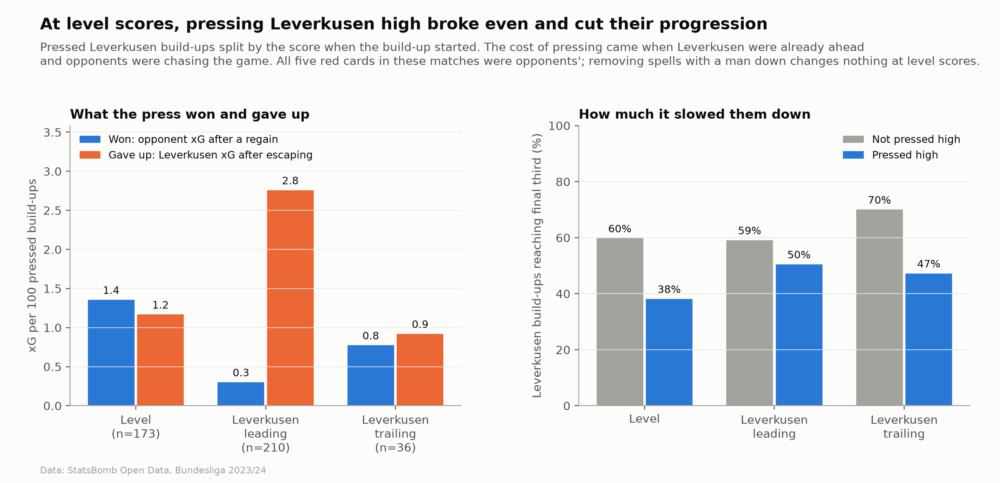
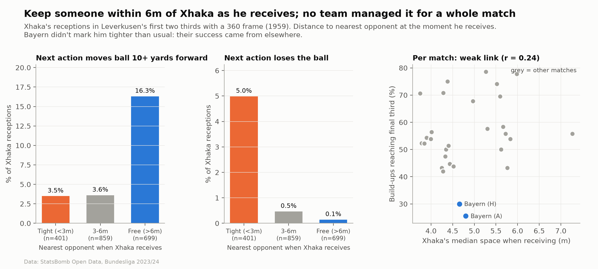

# Leverkusen 2023/24: opposition report

An opposition analysis of Bayer Leverkusen's unbeaten 2023/24 Bundesliga season, built around two coach's questions:
**"Should we press them high, and if so, how?"** and **"How do we attack them?"**

Data: [StatsBomb Open Data](https://github.com/statsbomb/open-data). All 34 league matches, event data plus 360 freeze frames.

**Read the report:** [report/Leverkusen_2023-24_Opposition_Report.pdf](report/Leverkusen_2023-24_Opposition_Report.pdf)

**Watch the video analysis:** [youtube.com/watch?v=JNXC03EhMBE](https://www.youtube.com/watch?v=JNXC03EhMBE)

## Main findings
- High pressing cuts Leverkusen's progression: build-ups reaching the final third fall from 60% to 45% (38% at level scores).
- At level scores, a high press roughly breaks even on chances. Most of its cost came when opponents were already behind and chasing the game.
- Winning the ball is not enough: Bochum won it as often as Bayern but gave it straight back.
- Block passes into Xhaka and keep a player within 6 metres of him: his forward passing drops from 16% to under 4%.
- Against them: carry the ball out of their press, attack the flanks rather than the middle, and make set pieces count.
- Every key claim has a 90% bootstrap interval (`src/uncertainty.py`); claims that didn't survive are labelled as not proven.

## Figures
All 20 chart files are in `figures/`. The report uses 13 of them, numbered in reading order (Figure 1–13), plus six annotated video stills (Video A–F).

| # | Figure | # | Figure |
|---|---|---|---|
| 1 | Build-up exit channels | 11 | Build-up pass network: normal vs Bayern |
| 2 | Press height vs progression, per match | 12 | Xhaka: space when receiving vs what he does next |
| 3 | Player press resistance | 13 | Pressed vs not pressed build-ups |
| 4 | Goal kicks vs number of pressers (small sample) | 14 | Press risk vs reward, per match |
| 5 | Expected Threat (xT) model | 15 | Leverkusen's press and counter-press |
| 6 | Exit routes valued with xT | 16 | Where Leverkusen concede |
| 7 | Build-up turnover map | 17 | Beating Leverkusen's press |
| 8 | Case study: Bayern, Frankfurt, Bochum | 18 | Press risk by game state |
| 9 | Case study: pressure maps | 19 | Goals by time, late goals |
| 10 | Case study: where the goals came from | 20 | Why they score late goals |




## Run it
```bash
python3 -m venv .venv
.venv/bin/pip install -r requirements.txt
cd src
../.venv/bin/python data.py          # downloads and caches the data (first run takes a few minutes)
../.venv/bin/python figures.py       # builds all figures into figures/
../.venv/bin/python uncertainty.py   # 90% intervals for the key claims
```
Each analysis module (`analysis.py`, `case_study.py`, `network.py`, `risk.py`, `defending.py`, `game_state.py`) also prints its own findings when run directly.

## Structure
- `src/data.py`: download and cache matches, events, 360 frames
- `src/analysis.py`: possessions, build-up, exit channels, turnovers, minutes played
- `src/xt.py`: Expected Threat model
- `src/case_study.py`: Bayern vs Frankfurt vs Bochum comparison
- `src/network.py`: build-up pass network, Xhaka's marking (360)
- `src/risk.py`: what pressing high won and gave up
- `src/game_state.py`: score-state check, late goals
- `src/late_goals.py`: why Leverkusen score so many late goals
- `src/clip_list.py`: exact video moments for each recommendation (`report/clip_list.csv`)
- `report/stills/`: annotated freeze frames from my video review (Video A–F in the report). The video file is not in the repo because the footage belongs to the broadcaster; the annotated analysis is [on YouTube](https://www.youtube.com/watch?v=JNXC03EhMBE).
- `src/defending.py`: Leverkusen's press, counter-press, where they concede
- `src/uncertainty.py`: cluster bootstrap intervals
- `src/figures.py`: all report charts
- `ROADMAP.md`: step-by-step plan, findings and quality checks

## Conventions
- Pitch units are StatsBomb yards (120 x 80); 360 distances are converted to metres.
- Matches are labelled from the opponent's side: (H) = at the opponent's ground, (A) = at Leverkusen, opponent's goals first. E.g. Bayern (A) 0-3 = Bayern lost 0-3 at Leverkusen.
- Restarts only count as the source of a shot if it came within 10 seconds.

Data provided by StatsBomb.
